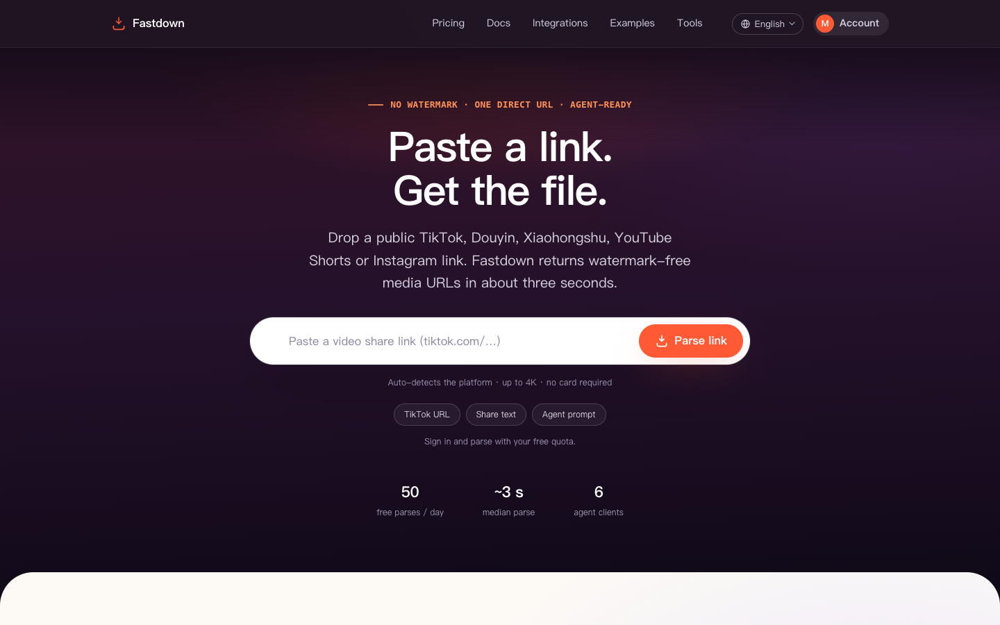
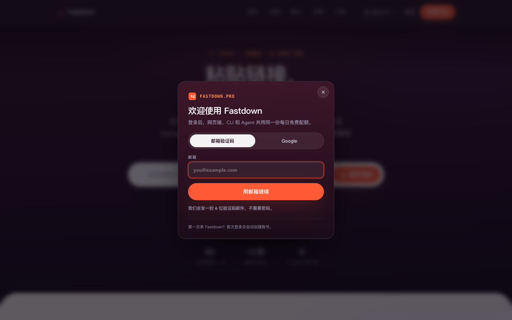
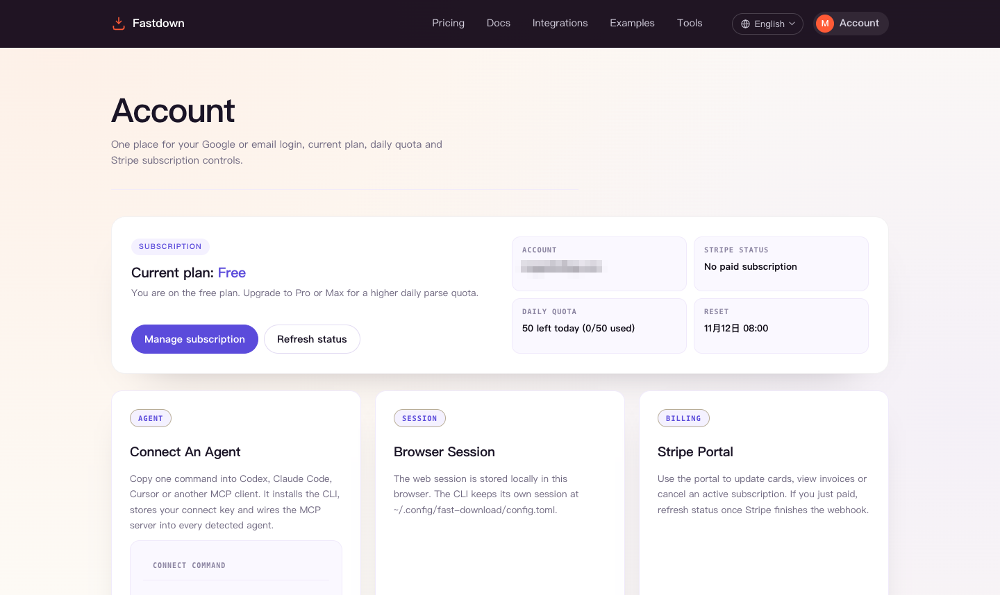
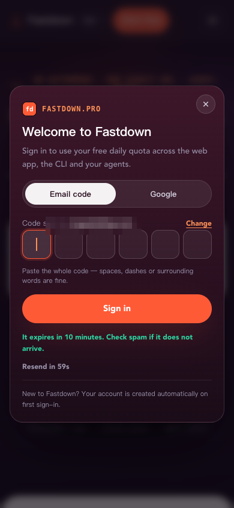

<div align="center">


# Fastdown

**一条公开分享链接 → 无水印直链。**
网页粘贴即用，CLI 一行装好，REST API 一个 POST 接入，MCP 让 Codex / Claude Code / Cursor 直接会下载。

Fastdown turns a public short-video share link into a no-watermark media URL.
Use it in the browser, from the `fast-download` CLI, through the REST API, or as an MCP tool for your agent.

<p>
  <a href="https://fastdown.pro/?utm_source=github&utm_medium=readme&utm_campaign=fastdown">
    
  </a>
  &nbsp;
  <a href="#cli--mcp">
    
  </a>
  &nbsp;
  <a href="docs/api.md">
    
  </a>
</p>

<p>
  
  
  
  
</p>

<sub>只处理公开分享链接 · 与各内容平台无隶属关系 · 请确保你对下载内容拥有合法权利</sub>

</div>



---

## 项目叫什么，在哪用

这个项目叫 **Fastdown**，官网就是入口：**<https://fastdown.pro>** —— 打开网页、粘贴链接、拿到文件，不需要安装任何东西。

同一个服务有几种叫法，指的都是它：

| 你会看到的叫法 | 指的是什么 |
|---|---|
| **Fastdown / fastdown.pro** | 产品名与官网，网页版入口，手机浏览器同样可用 |
| **fast-download** | 命令行可执行文件名，同时也是 MCP stdio 服务端 |
| **Fastdown API** | `https://fastdown.pro/api` 下的 REST 接口，给服务和 CI 用 |
| **TK无水印下载 / TikTok无水印 / 抖音无水印 / 小红书无水印** | 大家搜索这类需求时的说法，落到同一个解析服务 |
| **MCP video downloader / Agent video downloader** | 给 AI Agent 用的接入形态 |

> **本仓库是「用法仓库」，不是服务端源码。** 这里放的是 CLI、MCP、REST API 的调用示例与文档（[`examples/`](examples)、[`docs/`](docs)），解析服务本身的实现不在本仓库内。

---

## 这是什么

短视频平台只给你「在 App 里看」，不给你「把文件拿走」。想把一条公开视频存下来做素材、做备份、做二次创作，通常得装客户端、看广告、或者忍受带水印的低码率版本。

Fastdown 把这条链路做成了一个接口：**你只负责贴链接，平台识别、清晰度选择、去水印、直链签发都在云端完成，几秒后返回一条可下载的地址。**

| 传统做法 | Fastdown |
|---|---|
| 装客户端、看广告、导出还带水印 | 贴链接，直接给无水印直链 |
| 在手机上折腾文件管理器 | 网页版手机可用，CLI 落到本地 |
| 每个平台一套工具、一套登录 | 7 类平台一个入口、一份配额 |
| 写脚本要自己抓包、逆向、处理签名 | 一个 `POST /v1/parse`，Bearer 鉴权 |
| 让 Agent 帮忙下载，它只会打开浏览器 | MCP 工具 `download_video`，Agent 直接落盘 |

**和「下载器客户端」的区别**：Fastdown 是**解析服务**，不是伪装成播放器的下载器。它不代理视频流量、不落盘源文件，只把平台已经公开发出的媒体地址解析出来交给你 —— 所以它能在网页、CLI、API、Agent 四种形态里用同一套配额。

---

## 四种用法，按场景选

| 你的场景 | 用什么 | 怎么开始 |
|---|---|---|
| 偶尔下一条，手机/电脑都行 | **网页版** | 打开 <https://fastdown.pro>，粘贴链接，点 Parse |
| 批量、脚本化、要落到指定目录 | **CLI** | `curl -fsSL https://fastdown.pro/cli \| sh -s -- --agent auto` |
| 接进自己的服务、CI、工作流 | **REST API** | `POST https://fastdown.pro/api/v1/parse`，Bearer 鉴权 |
| 让 Codex / Claude Code / Cursor 自己会下载 | **MCP** | 一条带 key 的命令装好，Agent 里直接说「下载这个链接」 |

四种形态共用**同一个账号、同一份每日配额**。网页上登录一次，CLI 用同一个邮箱登录，配额就是同一份。

---

## 三步完成一次解析

| ① 复制链接 | ② 交给 Fastdown | ③ 拿结果 |
|---|---|---|
| 在平台里点「分享 → 复制链接」，整段分享口令也可以直接粘。 | 网页点 Parse，或 CLI `parse` / `download`，或 API 一个 POST。 | 网页给直链与预览，CLI 存到本地，API 返回 `media[].url`。 |

解析通常 **几秒内完成**（中位约 3 秒）。网页版免费账号每天 50 次，登录即得，不需要绑卡。

---

## 支持平台

| 平台 | 典型输入 | 说明 |
|---|---|---|
| 抖音 / Douyin | `v.douyin.com/...`、整段分享口令 | 默认优选无水印原画 |
| TikTok / TK | `tiktok.com/@user/video/...`、`vm.tiktok.com/...` | 无水印播放版，优先带音轨的流 |
| 小红书 | `xhslink.com/...`、笔记链接 | 视频笔记；图文笔记返回全部图片 |
| YouTube / Shorts | `youtube.com/watch?v=...`、`/shorts/...` | 混流上限 360p 时会给 `progressive_video_only_360p` 警告 |
| Instagram Reels | `instagram.com/reel/...` | 公开账号的 Reels |
| Facebook | `facebook.com/.../videos/...`、`fb.watch/...` | 公开视频 |
| X / Twitter | `x.com/.../status/...` | 公开推文中的视频 |

只处理**公开**内容：私密、已删除、需要登录或年龄验证的帖子会返回 `NOT_FOUND`，不会扣配额。

---

## 网页版

不想装东西就用网页：贴链接 → 解析 → 点下载。手机浏览器同样可用，登录用 Google 或邮箱验证码，不用记密码。

<table>
<tr>
<td width="50%"></td>
<td width="50%"></td>
</tr>
<tr>
<td align="center"><sub>登录 · 邮箱 6 位验证码或 Google，二者同一账号</sub></td>
<td align="center"><sub>账户 · 当前套餐、今日剩余配额与重置时间</sub></td>
</tr>
</table>

<p align="center">
  
  <br />
  <sub>手机端：390px 宽度下完整可用，验证码登录无需跳转 App</sub>
</p>

> 截图中邮箱已打码，配额与套餐为演示数据。

---

## CLI / MCP

安装（一条命令，自动识别系统与架构）：

```bash
curl -fsSL https://fastdown.pro/cli | sh -s -- --agent auto
```

登录一次，之后所有命令复用这份会话：

```bash
fast-download auth login          # 打开浏览器完成 Google 登录
fast-download auth status --json  # 查看当前账号与今日配额
```

解析与下载：

```bash
# 只看结果，不落盘（返回标题、作者、直链、配额）
fast-download parse "https://v.douyin.com/xxxx/" --json

# 解析并保存到本地，默认 ./downloads
fast-download download "https://v.douyin.com/xxxx/" --output ./downloads

# 只要音频 / 只要图片（图文笔记）
fast-download download "<link>" --media-type audio
fast-download download "<link>" --media-type image
```

配额与订阅：

```bash
fast-download quota --json
fast-download billing upgrade --plan pro
fast-download billing portal
```

把 MCP 接进本机所有支持的 Agent：

```bash
fast-download setup agent --auto          # 写入 Codex / Claude Code / Cursor / VS Code / OpenCode / Gemini CLI / Windsurf
fast-download setup agent --print         # 只打印 JSON 配置，不动文件
```

| Agent | 配置文件 |
|---|---|
| Codex | `~/.codex/config.toml`（`[mcp_servers.fast-download]`）+ `~/.codex/skills/fast-download/SKILL.md` |
| Claude Code | `claude mcp add -s user`，回退 `~/.claude.json` |
| Cursor | `~/.cursor/mcp.json` |
| VS Code | `<user-data>/Code/User/mcp.json` |
| OpenCode | `~/.config/opencode/opencode.json` |
| Gemini CLI | `~/.gemini/settings.json` |
| Windsurf | `~/.codeium/windsurf/mcp_config.json` |

写入是**追加式**的：已有的 MCP server 和无关配置不会被覆盖，已存在的 `fast-download` 条目会原样保留。装完重启 Agent 应用，然后直接说「把这个链接的视频下下来」。

MCP 服务端暴露三个工具：

| 工具 | 做什么 | 什么时候用 |
|---|---|---|
| `download_video` | 解析并保存到 `~/Downloads/fast-download` | 用户说「下载 / 保存 / 存下来」 |
| `parse_video` | 返回媒体地址与元数据，不落盘 | 用户要看信息、要链接、要预览 |
| `quota` | 返回当日解析配额 | 用户问「还能用几次」 |

细节与排查见 [`docs/mcp.md`](docs/mcp.md)、[`docs/cli.md`](docs/cli.md)。

---

## REST API

Base URL：`https://fastdown.pro/api`，所有受保护接口用 Bearer 鉴权：

```http
Authorization: Bearer <session_token 或 api_key>
```

- `fd_sess_...` —— 登录会话，网页 / CLI 用；
- `fd_live_...` —— 长期 API Key，在 <https://fastdown.pro/integrations> 创建，给服务端、CI、常驻 Agent 用，最多 3 个，只在创建时显示一次。

```bash
curl -sS https://fastdown.pro/api/v1/parse \
  -H "Authorization: Bearer $FASTDOWN_API_KEY" \
  -H "Content-Type: application/json" \
  -d '{"url":"https://www.tiktok.com/@yeuphimzz/video/7237370304337628442"}'
```

返回（有删减）：

```json
{
  "ok": true,
  "data": {
    "platform": "tiktok",
    "title": "Shin godzilla #movie",
    "author": "yeuphimzz",
    "media": [
      { "type": "video", "url": "https://...", "watermark": false }
    ],
    "cover_url": "https://...",
    "duration": 88,
    "warnings": [],
    "quota": { "plan_id": "free", "daily_limit": 50, "used": 3, "remaining": 47, "reset_at": "2026-11-13T00:00:00.000Z" },
    "elapsed_ms": 1299
  }
}
```

`media` 是**候选列表，按推荐顺序排列**，`media[0]` 就是最优选择：通常是带音轨的最高画质混流；请求音轨或内容本身没有视频时会附带一条 `type: "audio"`；图文笔记返回全部图片。`quality`、`ext` 是可选字段，缺省按 `mp4` 处理 —— 客户端的正确写法是「先看 `type`，`ext` 缺省补 mp4」，不要假设字段一定存在。

核心端点：

| 方法 | 路径 | 作用 |
|---|---|---|
| `POST` | `/v1/parse` | 解析一条公开链接，成功扣 1 次配额 |
| `GET` | `/v1/quota` | 当前套餐与今日余量 |
| `GET` | `/v1/me` | 当前账号 |
| `GET` `POST` | `/v1/keys` | 列出 / 创建 API Key（仅会话可用） |
| `POST` | `/v1/keys/{id}/rotate` | 轮换：旧 Key 立刻失效 |
| `POST` | `/v1/keys/{id}/revoke` | 立即吊销 |
| `POST` | `/v1/billing/checkout` | 创建 Stripe 订阅 |
| `POST` | `/v1/billing/portal` | 打开订阅管理 |
| `GET` | `/v1/health` | 健康检查，无需鉴权 |

常见的解析错误（完整表见 [`docs/api.md`](docs/api.md)）：

| HTTP | `error.code` | 含义 |
|---:|---|---|
| 400 | `INVALID_INPUT` | `url` 缺失或不是可用链接 |
| 422 | `UNSUPPORTED_URL` | 平台不支持 |
| 422 | `NOT_FOUND` | 帖子私密、已删除或需要年龄验证 |
| 422 | `NO_MEDIA` | 解析成功但帖子里没有可下载媒体 |
| 429 | `QUOTA_EXCEEDED` | 今日配额用完 |
| 503 | `UPSTREAM_RATE_LIMITED` | 上游限流，稍后重试 |
| 504 | `UPSTREAM_TIMEOUT` | 上游超时 |

**上游失败与无媒体结果不扣配额**；`error.retryable` 会告诉你值不值得重试。

机器可读的接口描述在 <https://fastdown.pro/openapi.json>，本仓库也存了一份 [`openapi.json`](openapi.json) 方便导入 Postman / Insomnia。

---

## 代码示例

```
examples/
├── curl/
│   ├── parse.sh        # 最小解析请求
│   ├── download.sh     # 解析 + 下载到本地（jq）
│   └── quota.sh        # 查配额
├── node/
│   ├── parse.mjs       # Node 18+，零依赖 fetch
│   └── download.mjs    # 解析 + 流式落盘
├── python/
│   ├── parse.py        # 仅用标准库 urllib
│   └── download.py     # 解析 + 下载，无第三方依赖
├── go/
│   ├── go.mod          # 独立小模块，方便直接 go run
│   └── main.go         # net/http，单文件
└── mcp/
    ├── codex.toml      # Codex 配置片段
    ├── claude.json     # Claude Code / Cursor / VS Code 通用片段
    └── README.md       # 各客户端接入说明
```

所有示例只读一个环境变量：

```bash
export FASTDOWN_API_KEY="fd_live_xxxxxxxx"
```

然后：

```bash
bash examples/curl/parse.sh "https://v.douyin.com/xxxx/"
node examples/node/parse.mjs "https://v.douyin.com/xxxx/"
python3 examples/python/download.py "https://v.douyin.com/xxxx/" -o ./downloads
cd examples/go && go run . -o ../../downloads "https://v.douyin.com/xxxx/"
```

示例代码用 MIT 许可，可以直接粘进你的项目里改。

---

## 计费与配额

| 套餐 | 月费 | 每日成功解析 | 适合 |
|---|---:|---:|---|
| Free | $0 | 50 | 试用、偶尔用 |
| Pro | $5 | 1,000 | 日常创作、个人自动化 |
| Max | $10 | 3,000 | 团队、批量流水线 |

三条规则，写死在计费里：

1. **解析失败不扣配额** —— 上游超时、链接失效、没有媒体，都不算一次；
2. **同一份配额跨端共享** —— 网页、CLI、API、Agent 用的是同一个账号的同一份余量；
3. **配额按 UTC 自然日重置** —— 账户页会显示准确的余量与下次重置时间（北京时间每天 08:00）。

订阅走 Stripe Checkout，卡与 Apple Pay 都支持，随时在 Billing Portal 取消。

---

## 项目状态

| 项 | 值 |
|---|---|
| 用法仓库版本 | v0.6.0（与服务端发版同步刷新） |
| 官网 / 网页版 | <https://fastdown.pro> |
| API Base | <https://fastdown.pro/api> |
| 健康检查 | <https://fastdown.pro/api/v1/health> |
| OpenAPI | <https://fastdown.pro/openapi.json> |
| 支持 Agent | Codex · Claude Code · Cursor · VS Code · OpenCode · Gemini CLI · Windsurf |

服务是常年在线的商业服务，本仓库随版本更新文档与示例。若你发现文档与线上行为不一致，欢迎开 issue 指出具体接口与时间。

---

## 常见问题

<details>
<summary><b>Fastdown 是什么？和「无水印下载器」有什么区别？</b></summary>

<br />

Fastdown 是一个**解析服务**：你给它一条公开的短视频分享链接，它返回这条内容的无水印媒体直链与元数据。它不做客户端下载器那套「伪装播放器 + 本地解密」，也不代理视频流量 —— 所以同一套能力可以同时以网页、CLI、REST API、MCP 四种形态提供给你。

</details>

<details>
<summary><b>抖音 / TikTok 无水印下载怎么用？</b></summary>

<br />

三种方式，选一个就行：

1. 打开 <https://fastdown.pro>，粘贴分享链接或整段分享口令，点 Parse，然后下载；
2. 装 CLI：`curl -fsSL https://fastdown.pro/cli | sh -s -- --agent auto`，然后 `fast-download download "<链接>"`；
3. 自己的程序里 `POST /api/v1/parse`，拿 `data.media[0].url`。

默认就返回无水印版本，不需要额外参数。

</details>

<details>
<summary><b>需要安装吗？手机上能用吗？</b></summary>

<br />

网页版不需要安装，手机浏览器打开 <https://fastdown.pro> 就能用，登录支持邮箱验证码，不用跳转 App。CLI 是给桌面和服务器用的，装与不装都不影响网页版。

</details>

<details>
<summary><b>免费吗？怎么收费？</b></summary>

<br />

免费账号每天 50 次成功解析，登录即得，不需要绑卡。超出后可以升到 Pro（$5/月，1,000 次/天）或 Max（$10/月，3,000 次/天）。**只有解析成功才计数**，失败、无媒体、上游超时都不扣。

</details>

<details>
<summary><b>解析失败了会扣配额吗？</b></summary>

<br />

不会。配额只在拿到可用媒体结果时扣一次；`QUOTA_EXCEEDED` 只会在余量真的为 0 时出现。如果你看到「失败也扣了」，那大概率是上游返回了可用结果但下载阶段失败 —— 这种情况请带 `request_id` 开 issue。

</details>

<details>
<summary><b>API 和 CLI 用的是同一个账号吗？</b></summary>

<br />

是。CLI 登录得到的会话（`fd_sess_...`）和在 <https://fastdown.pro/integrations> 创建的 API Key（`fd_live_...`）都指向同一个用户，配额、账单、解析记录完全一致。区别只是用途：会话给人用，Key 给机器用。

</details>

<details>
<summary><b>把 Key 交给 Agent 安全吗？</b></summary>

<br />

Key 只在创建时显示一次，服务端只存 `sha256` 与前 12 位前缀；它不能创建或吊销 Key（那需要登录会话），所以泄露的 Key 无法自我续命。怀疑泄露就在 Integrations 页面轮换，旧 Key 立刻失效。CLI 也**不会**让 Agent 接触你的 Google 密码 —— 登录是在系统浏览器里完成的。

</details>

<details>
<summary><b>支持哪些平台？会支持更多吗？</b></summary>

<br />

目前覆盖抖音、TikTok、小红书、YouTube / Shorts、Instagram Reels、Facebook、X。新平台取决于上游解析能力，通常先在网页版灰度。缺哪个平台可以开 issue 说需求，但本仓库不接受「帮我下这一条」的代下载请求。

</details>

<details>
<summary><b>Is Fastdown an official TikTok or Douyin tool?</b></summary>

<br />

No. Fastdown is an independent service, not affiliated with, endorsed by, or sponsored by TikTok, ByteDance, Douyin, Xiaohongshu, YouTube, Instagram, Facebook or X. It only resolves **public** share links that the platforms already expose, and it does not host or redistribute the media files.

</details>

<details>
<summary><b>Can I call the API from Python, Node or Go?</b></summary>

<br />

Yes. The API is plain JSON over HTTPS with a Bearer token, so any HTTP client works. This repository ships zero-dependency examples in [`examples/`](examples) for curl, Node 18+, Python 3 (stdlib only) and Go — copy them as a starting point.

</details>

---

## 仓库边界与免责

- 本仓库只包含**文档、示例代码与界面截图**，不包含 Fastdown 服务端的任何实现，也不包含任何绕过平台保护的代码。
- Fastdown 是独立第三方服务，与抖音、TikTok、字节跳动、小红书、YouTube、Instagram、Facebook、X 均无隶属、授权或背书关系；相关名称与标识归各自权利人所有。
- 服务只处理**公开分享链接**：不解析私密内容，不提供账号登录态，不破解付费墙。
- 使用者应自行确保对下载内容拥有合法权利，并遵守所在地法律法规与平台服务条款。
- 界面截图中的邮箱、Key 已打码，配额与金额为演示数据；截图中的内容封面与名称版权归原权利人，仅作界面示意。
- 示例代码采用 [MIT](LICENSE)；文档与截图采用 CC BY-NC 4.0，可署名转载、不可商用。

---

<div align="center">
<sub>

**[打开 fastdown.pro →](https://fastdown.pro/?utm_source=github&utm_medium=readme&utm_campaign=fastdown&utm_content=footer)** · 文档问题请开 issue · 安全漏洞请私下联系，不要公开提交

</sub>
</div>
